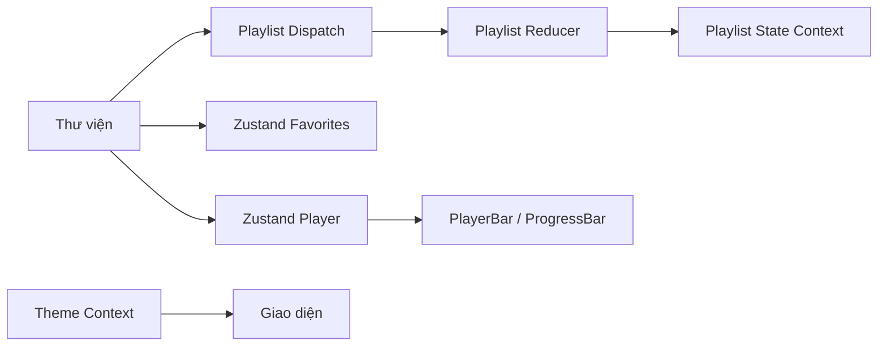

# Âm sắc — thư viện nhạc mô phỏng

Ứng dụng web một trang để khám phá thư viện gồm 10.000 bản nhạc được tạo bằng thuật toán xác định. Có tìm kiếm, lọc, sắp xếp, phát nhạc mô phỏng, yêu thích, playlist và giao diện sáng/tối. Ứng dụng chạy hoàn toàn phía trình duyệt, không cần API key hay backend và không phát âm thanh thật.

## Chức năng

- Tìm kiếm tên bài hát/ca sĩ (không phân biệt hoa thường, hỗ trợ tìm không dấu), debounce 300 ms.
- Lọc theo thể loại, sắp xếp theo tên hoặc thời lượng.
- Hiển thị 10.000 bài bằng `FixedSizeList` của `react-window` v1 (viewport 560 px, hàng 56 px).
- Trình phát mô phỏng với hàng đợi, phát/tạm dừng, trước/sau, tua và tiến trình theo giây.
- Lưu bài yêu thích bằng Zustand persist (`music-favorites`).
- Tạo/xóa playlist, thêm/xóa bài và lưu vào localStorage (`music-playlists`).
- Giao diện sáng/tối được lưu trong localStorage.
- Các trang Favorites, Playlists và Playlist Detail được tải lười bằng React Router và `React.lazy`.

## Công nghệ

React 18, TypeScript strict, Vite, React Router DOM v6, Zustand, react-window v1, Vitest, jsdom, React Testing Library và user-event. Font DM Sans, DM Mono và Playfair Display được đóng gói cùng ứng dụng, bao gồm glyph tiếng Việt; ứng dụng không cần kết nối dịch vụ font bên ngoài.

## Cấu trúc

```text
src/
├── App.tsx, main.tsx, types.ts
├── contexts/                 # Playlist và Theme context
├── data/                     # Generator và dữ liệu 10.000 bài
├── features/
│   ├── library/              # Tìm kiếm, lọc, virtualization, SongRow
│   ├── player/               # Zustand player, PlayerBar, ProgressBar
│   ├── favorites/            # Zustand persist và trang yêu thích
│   └── playlists/            # Reducer, logger, trang danh sách/chi tiết
├── hooks/                    # useDebounce
├── test/                     # Helper render với providers
└── utils/                    # Tiện ích định dạng
```

## Yêu cầu và cách chạy trên Windows

- Node.js 22.12 trở lên và npm.
- Mở PowerShell tại thư mục dự án:

```powershell
npm install
npm run dev
```

Vite in địa chỉ local trong terminal. Mở địa chỉ đó bằng trình duyệt.

## Kiểm tra

```powershell
npm test
npm run coverage
npm run build
```

Vitest chạy ở chế độ một lần (không bật watch). Coverage được xuất ra terminal và `coverage/`. Ngưỡng dòng tối thiểu là 70% cho các file trong `src/features/**` và `src/utils/**`.

## Quản lý state

- Zustand quản lý queue/player và danh sách ID yêu thích; trạng thái yêu thích được persist bằng middleware `persist`.
- Playlist dùng `useReducer(withLogger(playlistReducer))`. State và dispatch nằm trong hai Context riêng, còn reducer giữ các thao tác thuần và bất biến. Khởi tạo an toàn từ localStorage trước khi đồng bộ các thay đổi.
- Theme có Context riêng để đổi theme toàn ứng dụng.



## Hiệu năng và kiểm tra theo yêu cầu

- `FixedSizeList` chỉ dựng những hàng nằm trong viewport thay vì tạo 10.000 DOM rows cùng lúc.
- Input tìm kiếm và giá trị debounce được tách riêng. Dữ liệu lọc/sắp xếp được memo hóa; `SongRow` được bọc `React.memo`.
- PlayerBar chọn riêng queue, chỉ số hiện tại và trạng thái phát; chỉ ProgressBar đọc `position`, nên nhịp 1 giây không làm toàn bộ thư viện đăng ký vào state đó.
- `npm test` kiểm tra dữ liệu, format, debounce, reducer, player, SongRow, tìm kiếm/lọc, trang playlist, chi tiết và favorites. Có thể kiểm tra thêm các route trực tiếp bằng `/`, `/favorites`, `/playlists` và `/playlists/:id`.
- Các khóa localStorage để kiểm tra persistence: `music-favorites`, `music-playlists`, `music-theme`.

## Giới hạn có chủ đích

- Tên bài hát và nghệ sĩ là dữ liệu giả lập, sinh ổn định theo thuật toán; chúng không đại diện cho thu âm hay nghệ sĩ có thật.
- Phát/tạm dừng và tiến trình chỉ là mô phỏng bằng state và bộ đếm giây; không có âm thanh.
- Dữ liệu được lưu cục bộ trên trình duyệt; không đồng bộ giữa thiết bị và không có dịch vụ backend.
- `npm audit` còn báo hai cảnh báo mức moderate trong React Router v6. Đề bài yêu cầu v6; nâng lên v7 để loại cảnh báo sẽ vi phạm ràng buộc phiên bản.

Ảnh chụp bảng coverage thực tế: [`coverage.png`](./coverage.png).
